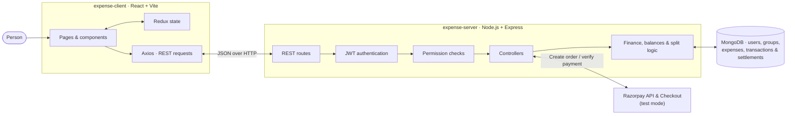
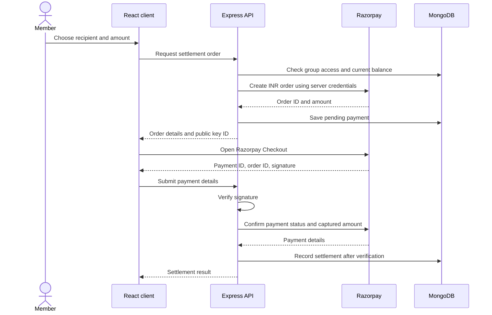

# 💸 MergeMoney

### Personal money, shared clearly.

**MergeMoney** brings everyday expense tracking and group bill-splitting into one place. Track income and spending, share costs with the people you travel, live, or plan with, and see who owes whom—without juggling spreadsheets, chat history, and separate finance apps.

> **The problem:** Shared expenses get scattered across receipts, messages, and memory. People lose track of who paid, how a bill was split, and whether it was settled. Personal spending ends up in yet another disconnected place.
>
> **The idea:** Keep personal transactions and group expense activity together, calculate fair balances, and make the settlement history visible to the people involved.

---

## ✨ What you can do

### 👤 Keep up with personal finances

- Record income and expenses with an amount, category, date, and description.
- Review a personal finance summary and transaction history.
- Bring a member's share of group expenses into their personal transaction history.

### 👥 Split expenses with a group

- Create groups for trips, households, events, or ongoing shared costs.
- Add group expenses and choose who participated.
- Split amounts evenly, assign exact amounts, or use weighted shares.
- Review expense history, member balances, and settlements.
- See a group activity/audit history.

### 🔐 Keep access intentional

- Register with an email and password, or sign in with Google.
- Protect authenticated API routes with JWTs stored in HTTP-only cookies.
- Use role-based permissions for actions across the app.
- Assign group member roles, including read-only viewer access.

### 💳 Settle up with Razorpay

- Start an INR group settlement through Razorpay Checkout.
- Create orders and verify payment signatures on the server.
- Confirm payment status with Razorpay before recording a settlement.
- Keep Razorpay credentials on the backend; the frontend receives only the public key ID.

**Payment status:** Razorpay is configured for **test mode only** in this project. The server requires a key ID beginning with `rzp_test_` and rejects live keys. The current flow records a paid group settlement after payment verification; it does **not** implement automatic payouts to a group member.

---

## 🏗️ Architecture

The client and API are separate applications. The React client talks to the Express API over REST; the API applies authentication and permissions, runs domain logic, and persists records in MongoDB. Razorpay is an external checkout/payment-verification provider for group settlements.



### Payment lifecycle



---

## 🧰 Technology

| Area | Technologies |
|---|---|
| Client | React 19, Vite, React Router, Redux Toolkit, Axios |
| UI | Bootstrap 5, Bootstrap Icons |
| API | Node.js, Express 5 |
| Data | MongoDB, Mongoose |
| Authentication | JWT, HTTP-only cookies, bcrypt, Google OAuth |
| Payments | Razorpay Checkout and server-side API verification |
| Tests | Node.js built-in test runner |

---

## 📁 Repository layout

```text
.
├── expense-client/                 # React single-page application
│   ├── src/
│   │   ├── components/             # Shared layouts and UI
│   │   ├── pages/                  # Home, finance, groups, login, etc.
│   │   ├── rbac/                   # Client-side permission helpers
│   │   └── redux/                  # Client state
│   ├── .env.example
│   └── package.json
├── expense-server/                 # Express REST API
│   ├── src/
│   │   ├── controllers/            # Request handlers and domain workflows
│   │   ├── dao/                    # Data access
│   │   ├── middlewares/            # Authentication and authorization
│   │   ├── model/                  # Mongoose schemas
│   │   ├── routes/                 # API route definitions
│   │   ├── services/               # Balances, splits and finance sync
│   │   └── utility/                # Shared permissions and helpers
│   ├── test/
│   ├── .env.example
│   └── package.json
└── README.md
```

---

## 🚀 Run locally

### Prerequisites

- Node.js 20 or newer and npm
- MongoDB locally or a MongoDB connection URI
- A Google OAuth **Web application** client ID if you want Google sign-in
- Razorpay **Test Mode** API keys if you want to try online settlements

### 1. Get the code

```bash
git clone https://github.com/hemeshhere/Expense-App.git
cd Expense-App
```

### 2. Configure the API

```bash
cd expense-server
npm install
```

Copy `expense-server/.env.example` to `expense-server/.env` and set values for your environment:

```dotenv
MONGO_DB_CONNECTION_URI=mongodb://127.0.0.1:27017/expense-app
PORT=5001
CLIENT_URL=http://localhost:5173
JWT_SECRET=replace-with-a-long-random-secret

# Optional: enable Google sign-in with the same client ID used by the frontend
GOOGLE_CLIENT_ID=your-google-web-client-id

# Optional: Razorpay Dashboard > Test Mode > API Keys
RAZORPAY_KEY_ID=rzp_test_your_key_id
RAZORPAY_KEY_SECRET=your_test_key_secret
```

Generate a unique, long JWT secret for your local environment. For Google sign-in, configure `http://localhost:5173` as an authorized JavaScript origin in Google Cloud Console. If Vite selects another port, add that origin too and keep `CLIENT_URL` aligned with it.

Run the API:

```bash
npm run dev
```

The API listens on port `5001` by default.

Alternatively, start the API from the repository root with `npm run dev:server`.

### 3. Configure and run the client

In another terminal:

```bash
cd expense-client
npm install
```

Copy `expense-client/.env.example` to `expense-client/.env`:

```dotenv
VITE_SERVER_ENDPOINT=http://localhost:5001
VITE_GOOGLE_CLIENT_ID=your-google-web-client-id
```

The Google client ID is optional unless you use Google sign-in. When enabled, it must match `GOOGLE_CLIENT_ID` in the API environment.

Start the client:

```bash
npm run dev
```

Open the local URL printed by Vite (normally `http://localhost:5173`).

### Production deployment (Vercel + Render)

Set the Vercel project root directory to `expense-client` and configure
`VITE_SERVER_ENDPOINT=/api`. The Vercel rewrites in
`expense-client/vercel.json` proxy API requests to the Render backend and serve
the React app for direct routes such as `/register`.

On Render, configure the backend environment with the production MongoDB URI,
a strong `JWT_SECRET`, `PORT` (if required by the service), and
`CLIENT_URL=https://expense-merge-v2.vercel.app`. Keep all backend secrets in
Render, never in Vercel's `VITE_` variables. Redeploy both services after
changing deployment settings.

> **Windows PowerShell:** From the repository root, you can copy the examples with `Copy-Item expense-server/.env.example expense-server/.env` and `Copy-Item expense-client/.env.example expense-client/.env`.
>
> **Keep secrets private:** `.env` files are for local use. Never commit your JWT secret, Google credentials, or Razorpay secret. Do not put `RAZORPAY_KEY_SECRET` in the client environment.

---

## 🔌 API overview

All routes below are served by the API on `http://localhost:5001`. Protected routes require the authenticated HTTP-only cookie.

| Area | Base path | Examples |
|---|---|---|
| Authentication | `/auth` | Register, login, Google sign-in, session check, logout |
| Profile | `/profile` | Current user information |
| Personal finance | `/personal-finance` | Summary and transaction create/read/update/delete |
| Groups | `/groups` | Group membership, expenses, balances, settlements and audit history |
| User management | `/users` | Permission-controlled user administration |

---

## 🧪 Checks

Run the backend tests:

```bash
cd expense-server
npm test
```

Build and lint the client:

```bash
cd expense-client
npm run build
npm run lint
```

---

## 🗺️ Where the project can grow

Potential next steps—not features currently promised by the app—include richer reporting, budgets, notifications, multi-currency support, and deployment automation. Contributions that improve usability, correctness, accessibility, or test coverage are welcome.

---

## 🤝 Contributing

1. Fork the repository and create a focused feature branch.
2. Keep changes scoped and add or update tests where appropriate.
3. Run the relevant backend tests and client checks.
4. Open a pull request describing the user problem and the solution.

---

## 📄 License

No repository-level license file is currently included. Please check with the maintainers before reusing or redistributing this project.
